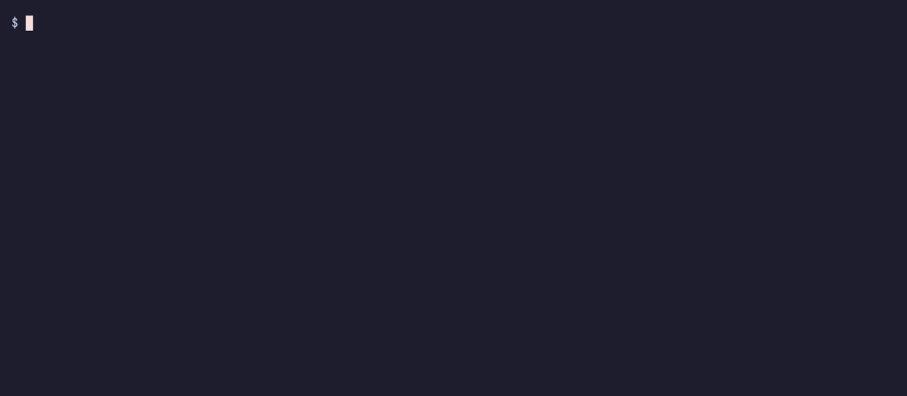

# whatdies

[](https://github.com/somaz94/whatdies/actions/workflows/ci.yml)
[](https://opensource.org/licenses/MIT)

**See what your AI agent's infrastructure command would actually destroy, before it runs.**



Same command, opposite verdict. A guard that reads the command text cannot tell these apart, because the text is identical:

```console
$ whatdies check "kubectl delete ns shop"
DENY
  deletes namespace shop on kind-whatdies-demo with 1 pod(s), 0 deployment(s), 0 statefulset(s), 1 PVC(s)
  PVC data -> PV pvc-da35d82e (1Gi) reclaim=Delete: the volume and its data are deleted

# reclaim policy changed to Retain; the command is identical
$ whatdies check "kubectl delete ns shop"
ASK
  deletes namespace shop on kind-whatdies-demo with 1 pod(s), 0 deployment(s), 0 statefulset(s), 1 PVC(s); its volumes have reclaim=Retain, so they outlive it
```

And the opposite trap, a command that looks routine:

```console
$ whatdies check "terraform apply tfplan"
DENY
  replaces aws_db_instance.main (aws_db_instance holds data)
```

whatdies is a single Go binary that runs as a [Claude Code](https://code.claude.com/docs/en/hooks) `PreToolUse` hook. It needs no API key and sends nothing anywhere: it reads your saved Terraform plan and asks your own `kubectl` read-only questions.

<br/>

## Why

Coding agents have run `terraform destroy` against production and taken the database and its snapshots with it ([AI Incident 1424](https://incidentdatabase.ai/cite/1424)). The developer in that case watched the command go by and did not stop it. An approval prompt only helps if the person can see what the command does, and `terraform apply` does not say.

<br/>

## Install

```bash
brew install --cask somaz94/tap/whatdies
whatdies install --claude
```

`install` adds one hook to `~/.claude/settings.json`, keeping everything else in the file and a backup beside it. Use `--project` for `./.claude/settings.json`, and `whatdies uninstall --claude` to remove it.

If the binary moves or is deleted, every shell command is blocked until you reinstall or remove the hook. That is on purpose: a hook that fails open is not a guard.

Try it without installing the hook:

```bash
whatdies check "terraform apply tfplan"
```

Exit codes are `0` no decision, `3` ask, `4` deny.

<br/>

## What it does

| Command | How it decides | Result |
|---|---|---|
| `terraform apply <planfile>` | Reads the saved plan file itself, without running terraform | Deletes or replaces a resource that holds data: **deny**. Any other delete or replace: **ask**. Otherwise no decision |
| `terraform apply`, `terraform destroy` with no saved plan | Nothing shows what they would do | **Deny**, and tells the agent to save a plan first |
| `kubectl delete` of a namespace, PVC or PV | Looks up the volumes behind it | `reclaim=Delete`: **deny**. `Retain` or no volumes: **ask** |
| `kubectl delete` of a StatefulSet | Reads its PVC retention policy | Claims deleted with it and `reclaim=Delete`: **deny**. Otherwise **ask** |
| `kubectl delete` of a CRD | Counts its instances | **Ask** |
| `helm uninstall`, `drain`, `state rm`, `--prune`, `--replicas=0` and similar | The verb alone | **Ask** |
| A command it cannot see into: `eval "$X"`, `curl ... \| bash`, `kubectl delete pod $POD` | The shape of the command | **Ask** |

Commands that are not infrastructure get no decision, in about two milliseconds. The rules, and how each one is decided, are in [docs/verdicts.md](docs/verdicts.md).

It never answers `allow`. It can only add friction, so your normal permission rules still apply to everything it lets through.

Claude Code's `bypassPermissions` mode does not switch it off: in a headless run under that mode, both a deny and an ask stopped the command. An ask in an interactive session under that mode has not been tested.

<br/>

## How it stays out of trouble

A guard that runs commands on an agent's behalf is itself a risk, so:

- **It does not run `terraform plan`.** That would execute agent-written code, such as a `data "external"` block, before you approve anything. The agent runs the plan through your normal permissions, and whatdies reads the file. Terraform itself refuses a saved plan that has gone stale.
- **It only ever calls `kubectl get`.** A server-side dry run of the delete needs delete rights, shows no cascade, and is one flag away from a real delete.
- **It will not probe a target the command chose.** With `--kubeconfig`, `--server`, an inline `KUBECONFIG=` or `./kubectl`, a credential plugin could run code the agent wrote, so it asks without looking.
- **Plan values stay out of messages.** A plan holds secrets in clear text, so only addresses, types and actions are decoded.
- **It fails closed.** A timeout, a crash, missing credentials or an unreadable plan becomes ask.

<br/>

## Limitations

This is a seatbelt for a mistaken agent, not a sandbox. It does not stop an agent trying to get around it.

- **Commands built at run time can get through.** Custom shell functions, a tool name assembled from variables, and scripts more than one level deep are not read. Run an agent you do not trust in a real sandbox.
- **It covers Terraform, kubectl and, by verb only, Helm.** A direct `aws rds delete-db-instance`, `DROP DATABASE` or `rm -rf` is out of scope. Run a text-matching guard such as [destructive_command_guard](https://github.com/Dicklesworthstone/destructive_command_guard) alongside it. If that guard refuses `terraform plan -destroy`, which whatdies recommends before a destroy, allow it there.
- **MCP tools are not checked.** The hook sees shell commands only.
- **A plan format whatdies does not know weakens deny to ask.** It decodes the saved plan itself, so no terraform or provider binary runs before you approve. Anything in the file it does not recognise, such as a field a newer Terraform adds, makes the verdict ask rather than a guess.
- **A plan file can be swapped** between the check and your approval of the prompt.
- **The list of resource types that hold data is a judgement call.** It lives in [`stateful.yaml`](internal/registry/stateful.yaml), and a type missing from it still gets ask.
- **Claude Code only so far.** Codex, Gemini CLI, Helm analysis and OpenTofu plans are planned.

<br/>

## Try the demo

Everything above comes from [`examples/demo/demo.sh`](examples/demo/demo.sh), against a throwaway [kind](https://kind.sigs.k8s.io/) cluster and a Terraform config with no cloud account. It uses its own temporary kubeconfig, so your current context is not touched.

```bash
make build && examples/demo/demo.sh
```

<br/>

## Development

See [docs/DEVELOPMENT.md](docs/DEVELOPMENT.md).

<br/>

## License

[MIT](LICENSE)
